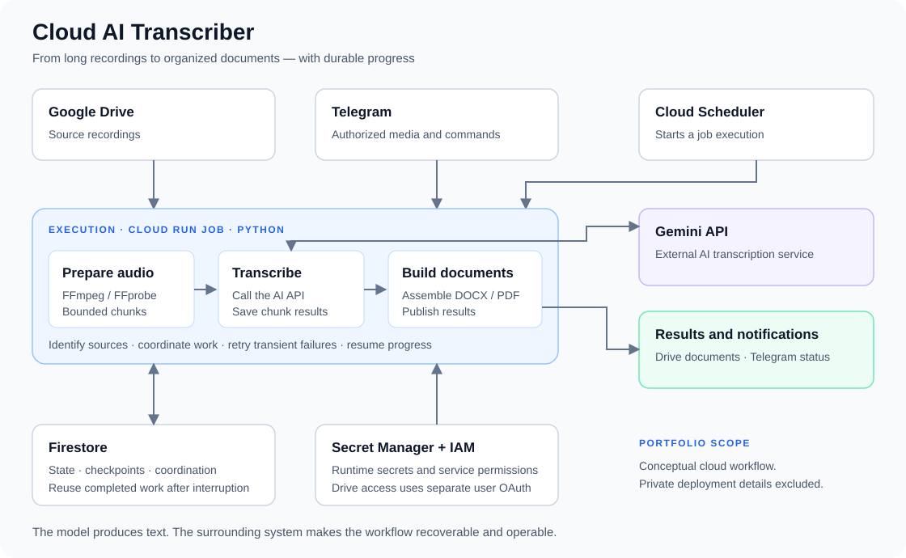
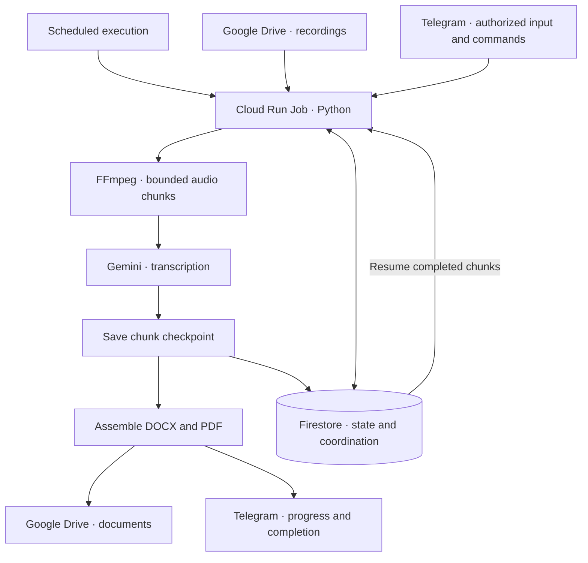

# Cloud AI Transcriber

**Audio recordings → AI transcription → organized documents, with recoverable cloud processing.**

This public repository is a **sanitized portfolio snapshot** of a personal project built with Python, Gemini, Google Drive, Telegram and Google Cloud. The code demonstrates the design; it is not a public transcription service. Production credentials, private recordings, transcripts, infrastructure identifiers and operational history are excluded.

[Guía en español para entender y presentar el proyecto](docs/GUIA_ENTREVISTA_ES.md)

## The problem

Long class recordings are difficult to review and organize. The workflow turns audio into DOCX/PDF documents, stores them in Drive and reports progress through Telegram. It is designed to resume interrupted work rather than repeatedly process an entire recording.

## Cloud workflow at a glance



<details>
<summary>View the editable Mermaid flow</summary>



</details>

**Reading the diagram:** Cloud Run executes the Python workflow. Gemini provides transcription. Firestore records processing state; Drive stores the source recordings and output documents. These services have different roles.

The cloud workflow presented here covers recordings from Drive and authorized Telegram media/operations. Legacy source adapters remain in the snapshot for historical compatibility and are not a claim of current cloud functionality.

## Why it is more than a model call

- **Bounded memory:** FFmpeg processes manageable audio chunks instead of loading a complete long recording.
- **Recovery:** Durable checkpoints let interrupted work reuse completed chunks.
- **Duplicate protection:** Source identities and reserved output IDs reduce repeated processing and duplicate uploads.
- **Coordination:** Firestore state and leases reduce overlapping executions.
- **Quality handling:** Retries, model fallback and selective recovery address different failure classes. A successful API call does not prove an accurate transcript.
- **Visibility:** Telegram status and a separate read-only dashboard help inspect progress.

These are design mechanisms, not a guarantee that failures or transcription errors cannot occur.

## Technology and responsibilities

| Technology | Role |
| --- | --- |
| Python 3.12 | Workflow and application logic |
| FFmpeg / FFprobe | Inspect and process audio |
| Gemini API | AI transcription |
| Drive API | Read recordings and publish documents |
| Telegram Bot API | Authorized input, commands and notifications |
| Cloud Run Jobs / Cloud Scheduler | Run and schedule cloud execution |
| Firestore | Durable state, checkpoints and coordination |
| Secret Manager / IAM | Runtime secrets and service permissions |
| Docker / GitHub Actions | Reproducible packaging and automated validation |

## Repository map

| Location | Responsibility |
| --- | --- |
| `main.py`, `phase12_entrypoint.py` | Orchestration and local/cloud entrypoints |
| `drive_*.py`, `telegram_*.py` | Input, output and notifications |
| `gemini_transcriber.py`, `quality_rescue_runtime.py` | Transcription and quality handling |
| `state_backend.py`, `state_store.py` | State, checkpoints and leases |
| `dashboard_app.py`, `dashboard/` | Read-only job-status interface |
| `tests/` | Regression and integration tests |
| `docs/` | Architecture and security documentation |

## My contribution and use of AI

I defined the problem and operating requirements, coordinated AI-assisted implementation, tested real recordings, investigated failures and validated cloud operation. Coding assistants helped implement the software; I do not claim to have hand-written every line.

The key learning was that an effective automation must also handle interrupted work, duplicate inputs, credentials, cost and day-to-day operation.

## Try the snapshot locally

You need Python 3.12, FFmpeg/FFprobe and your **own** Drive OAuth application, Gemini API key and Telegram bot. Copy `.env.example` to `.env` and configure your credentials and folders.

```bash
python -m venv .venv
.venv/bin/python -m pip install -r requirements.txt
.venv/bin/python -m unittest discover -s tests -v
```

On Windows, use `.venv\Scripts\python.exe` instead of `.venv/bin/python`.

These commands install dependencies and run tests; they do not provision or deploy the cloud system. Cloud operation requires independent IAM, Secret Manager, Firestore and scheduler configuration. The snapshot includes a legacy continuous local mode and a one-shot mode suitable for Cloud Run Jobs.

## Security and limitations

- Recordings and transcripts are private user content and must stay out of the public repository.
- Drive uses user OAuth; cloud service identity and IAM are a separate access boundary.
- Credentials belong in runtime configuration or a secrets manager.
- Monitoring needs its own access control; a user selector is not authorization.
- Transcription output can contain mistakes and requires review when accuracy matters.
- CI checks are not an independent security audit or a live production health check.

See [Architecture](docs/ARCHITECTURE.md), [Security model](docs/SECURITY_MODEL.md) and [Security policy](SECURITY.md).

**Portfolio version:** curated independently from the private operational project, with a fresh Git history.
